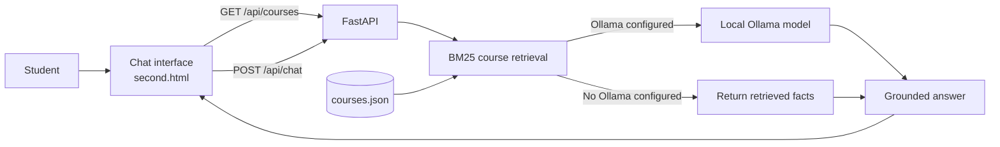

# Dotsquares CodeAI

**A course-advisor chatbot that retrieves relevant training programs and answers from course information—not made-up promises.**

Explore Dotsquares CodeAI’s sample course catalog, ask about course skills,
levels, durations, and career paths, and see which courses informed each answer.
The chatbot runs locally with retrieval-only responses; configure Ollama to add
conversational, retrieval-grounded answer generation.

> [!IMPORTANT]
> The included course catalog is prototype data, not verified official
> Dotsquares Academy information. Verify course availability, syllabus, fees,
> schedules, and career claims with the Academy before using this project with
> prospective students.

## What it does

- Searches course records with **BM25 lexical retrieval**.
- Returns matching source courses with each chatbot response.
- Uses an optional **local Ollama model** to generate a concise answer from
  retrieved course facts.
- Says when requested information is missing instead of inventing prices,
  schedules, or guarantees.
- Serves the chat interface and JSON API from one **FastAPI** application.
- Keeps the searchable catalog in a small, editable JSON file.

> **Retrieval note:** The current retriever uses BM25 keyword relevance. It does
> not use vector embeddings or a vector database, so semantically similar
> questions with very different wording may not match.

## See it in action

Ask questions such as:

- “How long is the Python course?”
- “Which course covers Docker and Kubernetes?”
- “What career paths are listed for AI and machine learning?”
- “Show me all courses.”
- “What fees are available for the Flutter course?”

The catalog does not currently list course prices, so the chatbot should say
that fees are not listed and recommend checking with Dotsquares Academy.

## Course catalog

| Program | Duration | Example topics |
|---|---:|---|
| Full-Stack Web Development (MERN & Next.js) | 4–6 months | React, Next.js, Node.js, MongoDB |
| AI, Machine Learning & Generative AI | 6 months | Python, PyTorch, NLP, LLMs |
| Python Full-Stack & Data Analytics | 4 months | Django, FastAPI, Pandas, SQL |
| Cross-Platform Mobile Apps | 3–4 months | Flutter, React Native, Firebase |
| Cloud Computing & DevOps Engineering | 4 months | AWS, Docker, Kubernetes, Terraform |
| UI/UX & Product Design Masterclass | 3 months | Figma, research, design systems |
| Software QA & Test Automation Mastery | 3 months | Selenium, API testing, Cucumber |

The catalog API is the source of truth; update
[`backend/app/data/courses.json`](backend/app/data/courses.json) to change
course details.

## Architecture



## Quick start

### Requirements

- Python 3.10 or newer
- Ollama is optional; chat works without it

### Windows (PowerShell)

Run these commands from the project root:

```powershell
py -3 -m venv .venv
.\.venv\Scripts\python.exe -m pip install -r backend\requirements.txt
Set-Location backend
..\.venv\Scripts\python.exe -m uvicorn app.main:app --reload
```

Open <http://127.0.0.1:8000>. The API reference is available at
<http://127.0.0.1:8000/docs>.

### macOS or Linux

Run these commands from the project root:

```bash
python3 -m venv .venv
.venv/bin/python -m pip install -r backend/requirements.txt
cd backend
../.venv/bin/python -m uvicorn app.main:app --reload
```

### Run the tests

In a second terminal, from the project root:

```powershell
.\.venv\Scripts\python.exe -m unittest discover -s backend\tests -v
```

On macOS or Linux, run:

```bash
cd backend
../.venv/bin/python -m unittest discover -s tests -v
```

## Optional: generate answers with Ollama

The default mode returns the retrieved course facts directly. To have a local
language model turn those facts into a conversational answer:

1. Install and start [Ollama](https://ollama.com/).
2. Pull a model. For example:

   ```powershell
   ollama pull qwen2.5:3b
   ```

3. Copy `backend/.env.example` to `backend/.env` and set:

   ```dotenv
   OLLAMA_BASE_URL=http://127.0.0.1:11434
   OLLAMA_MODEL=qwen2.5:3b
   ```

4. Restart the FastAPI server.

Ollama runs locally by default. The retrieved course context is sent to the
configured Ollama server. If a model is configured but Ollama is unavailable,
the chat API reports a service error rather than silently switching response
modes.

## API

### `GET /api/courses`

Returns the current course catalog as JSON.

### `POST /api/chat`

Request:

```json
{
  "question": "How long is the Python course?"
}
```

Example response:

```json
{
  "answer": "Based on the course information currently available: ...",
  "sources": [
    {
      "course_id": "python_ds",
      "course_name": "Python Full-Stack & Data Analytics"
    }
  ],
  "mode": "retrieval"
}
```

`mode` is `retrieval` when the API returns the retrieved facts directly and
`rag` when Ollama generates an answer from retrieved course context.

### `GET /health`

Checks the optional PostgreSQL connection used by the existing database
foundation. PostgreSQL is **not** needed to run the course catalog or chatbot.

## Keep the data accurate

Edit [`backend/app/data/courses.json`](backend/app/data/courses.json) to add
or update catalog entries. Each course record includes:

- `id`, `category`, and `name`
- `duration` and `level`
- `skills` and `description`
- `fees` and `career`

Keep facts specific and verified. If an official value is unknown, make that
clear in the data instead of estimating. The chat page, catalog endpoint, and
retriever all read this file.

## Project structure

```text
.
├── second.html                      # Main chatbot interface
├── backend/
│   ├── .env.example                  # Optional local configuration template
│   ├── app/
│   │   ├── data/courses.json         # Course knowledge source
│   │   ├── main.py                   # FastAPI routes and page serving
│   │   └── services/rag.py           # BM25 retrieval and Ollama generation
│   ├── tests/test_rag.py             # Retrieval and chat API tests
│   └── requirements.txt              # Backend dependencies
├── flowchart.md                      # Request flow and RAG notes
└── README.md                         # Project guide
```

## Troubleshooting

| Problem | What to check |
|---|---|
| The page does not load | Start Uvicorn from the `backend` directory and open `http://127.0.0.1:8000`. |
| The chat cannot reach the API | Open the page from FastAPI; opening `second.html` directly as a file will not provide the `/api/chat` endpoint. |
| Ollama answers return an error | Make sure Ollama is running, the model in `OLLAMA_MODEL` is installed, and `OLLAMA_BASE_URL` is correct. |
| The chatbot cannot answer a course question | Check the wording and verify that the relevant fact exists in `backend/app/data/courses.json`. |
| PostgreSQL health is unhealthy | Configure the database values in `backend/.env`; PostgreSQL is only needed for the database health check. |

## License

No license has been added yet. Unless a license is provided, the repository
does not grant permission to reuse, distribute, or modify this project.
