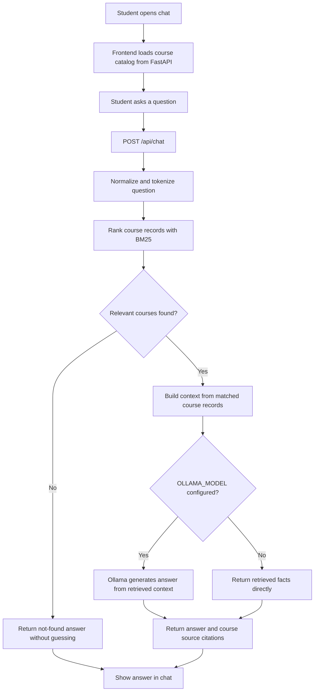

# Dotsquares CodeAI RAG flow

## Data source

`backend/app/data/courses.json` is the knowledge source for the course
directory, retrieval, and answer context. BM25 retrieval is lexical; it does
not require a vector database or embedding service. Configure a local Ollama
model to synthesize retrieved facts into conversational answers.

## API

- `GET /` serves the chatbot page.
- `GET /api/courses` returns the course records used by the UI.
- `POST /api/chat` accepts a question and returns an answer, source courses,
  and the response mode.
- `GET /health` checks the existing optional PostgreSQL connection.
